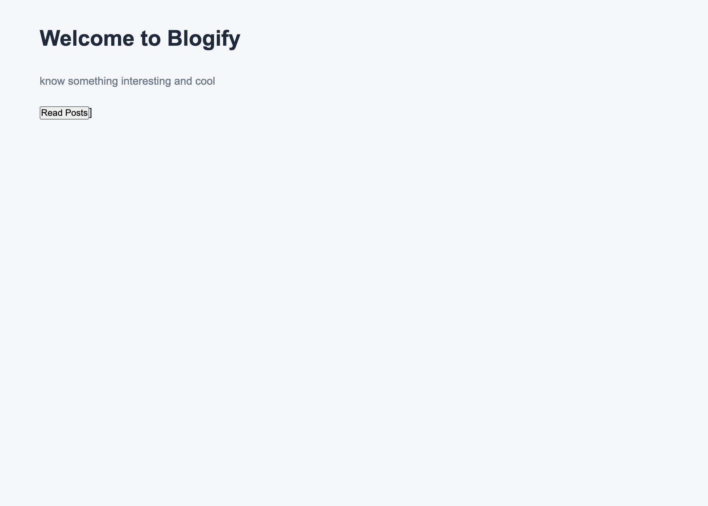
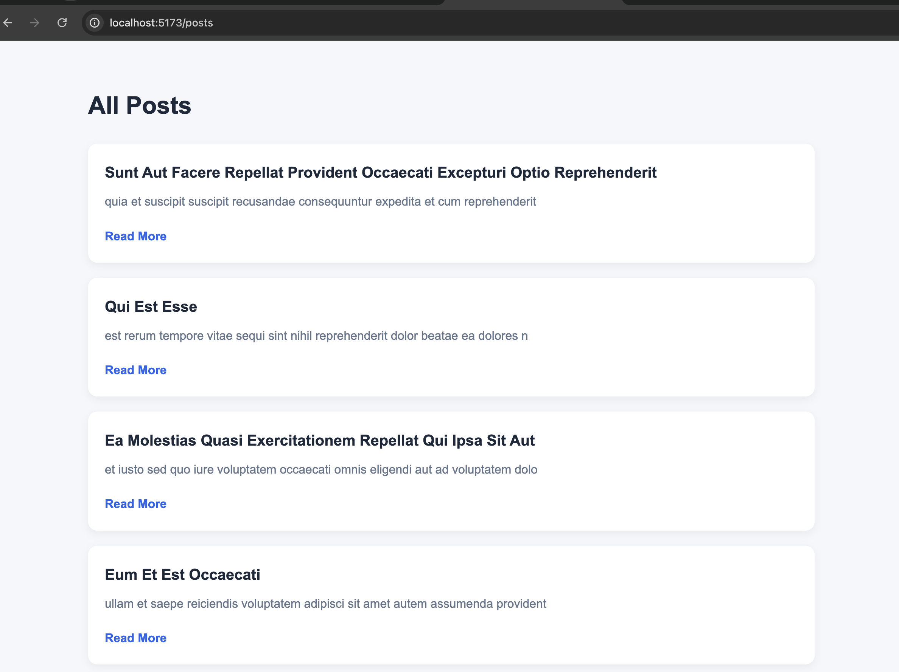

# PS1: Blogify - Blog Reader

A modern and responsive blog reader web application built with React and Vite. It allows users to browse blog posts fetched from an external API, view individual post details, and read corresponding comments.

---

## 📌 Project Overview

| Attribute | Details |
|---|---|
| **PS Number** | **PS1** (Problem Statement 1) |
| **Project Name** | **PS1: Blogify: blog reader** |
| **Live Demo** | [ps1-blogify-blog-reader.vercel.app](https://ps1-blogify-blog-reader.vercel.app/) |
| **Repository** | [github.com/hub-anand14/ps1-Blogify-blog-reader](https://github.com/hub-anand14/ps1-Blogify-blog-reader) |
| **Tech Stack** | React, React Router DOM, Vite, CSS3 |

---

## 🔗 Live Link

👉 **Deployed on Vercel:** [https://ps1-blogify-blog-reader.vercel.app/](https://ps1-blogify-blog-reader.vercel.app/)

---

## 🌐 APIs Used

This project utilizes the **JSONPlaceholder REST API** for mock blog posts and comments:

1. **Get All Posts:**
   - **Endpoint:** `GET https://jsonplaceholder.typicode.com/posts`
   - **Usage:** Fetches the list of all blog posts rendered on the `/Posts` page.

2. **Get Post Details:**
   - **Endpoint:** `GET https://jsonplaceholder.typicode.com/posts/:id`
   - **Usage:** Fetches specific post information by ID for detailed viewing.

3. **Get Post Comments:**
   - **Endpoint:** `GET https://jsonplaceholder.typicode.com/posts/:id/comments`
   - **Usage:** Fetches community comments associated with a specific blog post.

---

## 🗺️ Application Routes

| Route | Component | Description |
|---|---|---|
| `/` | `Home` | Landing page welcoming users with a direct CTA to explore posts |
| `/Posts` | `Posts` | Displays all blog posts in a clean card layout with previews and "Read More" action |
| `/Postdetials` | `PostDetails` | Detailed view of a post including full body content and reader comments |
| `/notfound` | `notFound` | Custom 404 page for unavailable or invalid routes |

---

## 📸 Screenshots

### 1. Home Page


### 2. All Posts Page


---

## 🚀 Getting Started Locally

### Prerequisites
- Node.js (v18 or higher recommended)
- npm or yarn

### Installation
1. Clone the repository:
   ```bash
   git clone https://github.com/hub-anand14/ps1-Blogify-blog-reader.git
   cd ps1-Blogify-blog-reader
   ```

2. Install dependencies:
   ```bash
   npm install
   ```

3. Start development server:
   ```bash
   npm run dev
   ```

4. Open `http://localhost:5173` in your browser.

---

## 🛠️ Built With
- **React 19**
- **Vite**
- **React Router v7**
- **Vanilla CSS**
